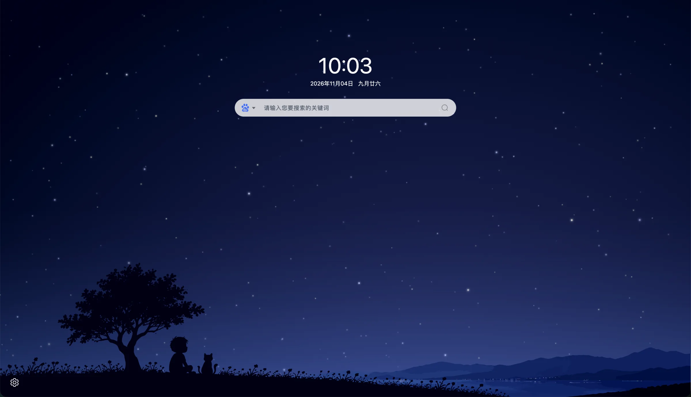

# 星屿 · 新标签页

「星屿」是一款 Chrome / Edge 新标签页扩展：把搜索、常用网站、书签和二十款小组件收进同一张起始页，配四套 canvas 动态主题与精选壁纸。不做账号、不接统计、不投放广告，数据只保存在本地。

## 功能

- **搜索**：百度、必应、哔哩哔哩等引擎一键切换，输入即联想，支持搜索历史与翻译入口
- **常用网站**：分类、拖拽排序、自定义图标与程序坞，可从浏览器书签批量导入
- **二十款小组件**：天气、热榜、日历黄历、电影日历、备忘、收藏夹、喝水提醒、下班与假期倒计时、汇率换算等，可独立开关、自由摆放
- **小工具**：二维码、加解密、PDF 合并拆分、图片压缩切分、人民币大写，还有 2048 与五子棋
- **主题**：星野、星野 2、雪夜、秋山四套 canvas 动态背景，也可选择必应每日壁纸或自建壁纸库
- **数据**：设置与内容仅存本地，配置和备忘可导出为 JSON，换电脑手动迁移

## 兼容性

Chrome 116 及以上（Manifest V3），Edge 同样适用。

## 链接

- 官网：<https://github.com/NIU-BIN/xingyu>
- 隐私政策：`privacy.html`
